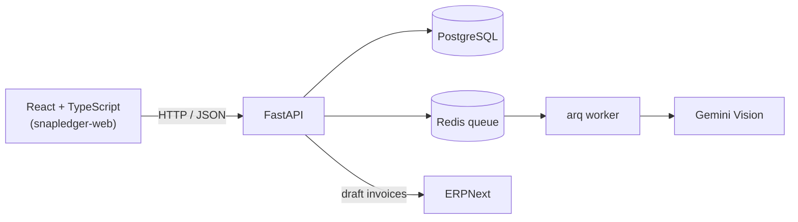

# SnapLedger

An API that turns a photo of a receipt or invoice into structured, reviewed data (vendor, date, amount, line items, category) using an LLM vision model instead of traditional OCR plus rule-based parsing. Confirmed invoices can then be pushed into ERPNext as draft Sales or Purchase Invoices.

Built to solve a gap that shows up in every ERP and finance system: the system is great at handling data once it is inside, but getting a messy real-world document into structured form in the first place is still manual almost everywhere.

> **Frontend:** the React + TypeScript app lives in [snapledger-web](https://github.com/DikshyaPaudel/snapledger-web). Together they cover the full flow: upload, review, save, and push to ERPNext.

<!-- Add a GIF or screenshot of the full flow here -->

## What it does

1. Upload a photo of a document: `POST /extract`
2. Get an instant job ID back. Extraction runs in the background (about 15 to 20 seconds), so the request doesn't block
3. Poll `GET /jobs/{job_id}`: structured data comes back (vendor, date, total, currency, category, line items, confidence score)
4. **Nothing is saved yet.** The frontend shows an editable review screen, so you can correct anything the model got wrong
5. Confirm: `POST /receipts` actually writes it to the database
6. `GET /receipts` and `GET /receipts/{id}`: browse everything saved
7. `POST /receipts/{id}/push`: push a saved Sales or Purchase Invoice into ERPNext as a **draft** invoice
8. `GET /summary`: total spend, receipt count, breakdown by category
9. `GET /duplicates`: flags likely duplicate submissions (same vendor, same amount, dates within a few days)

Two frontends use this API: the React app in [snapledger-web](https://github.com/DikshyaPaudel/snapledger-web) (the main one), and the original vanilla JS interface in `static/index.html`, served by FastAPI at `/app` and kept as a lightweight fallback.

## Architecture



## Tech stack

- **FastAPI**: async API layer, serves the JSON API and the original static frontend
- **Gemini vision API**: extraction (see "Why an LLM instead of OCR" below)
- **Redis + arq**: background job processing, so uploads return instantly instead of blocking for about 20 seconds
- **PostgreSQL + SQLAlchemy**: persistence
- **httpx**: calls the ERPNext REST API
- **Docker Compose**: local environment (api, worker, db, redis as separate services)
- **pytest**: test suite for endpoints, validation, and the job flow (mocked Redis and Gemini calls)
- **Frontends**: a React + TypeScript app (separate repo: Vite, TanStack Query, Tailwind CSS) and the original vanilla HTML/CSS/JS interface in `static/`. Both poll for job completion and show an editable review form before anything is stored

## API endpoints

| Method | Path | Purpose |
|---|---|---|
| GET | `/` | Health check |
| POST | `/extract` | Upload an image (form field `file`, up to 10 MB). Returns a `job_id` immediately |
| GET | `/jobs/{job_id}` | Poll for the result. A job can be `complete` and still contain an `error` (for example, not a receipt) |
| POST | `/receipts` | Save the user-confirmed document. The only place data is written |
| GET | `/receipts` | All saved documents, newest first |
| GET | `/receipts/{id}` | One saved document |
| POST | `/receipts/{id}/push` | Push to ERPNext as a draft invoice |
| GET | `/duplicates` | Likely duplicate groups |
| GET | `/summary` | Totals and breakdown by category |

Interactive docs are at `/docs` when the API is running.

## Why extraction and storage are two separate steps

Early versions of this saved straight to the database the moment extraction finished. That's a mistake in any real system handling financial data: an LLM's read of a blurry or unusual document can be wrong, and writing that straight to a ledger with no human checkpoint means errors go in silently.

So the architecture is deliberately split:

- **`POST /extract`** only reads the document and returns what the model saw. Nothing is persisted.
- **`POST /receipts`** is the only place a record actually gets written, and it's called with whatever the user confirmed, which may differ from what the model originally extracted.

This mirrors how a reasonable ERP handles OCR and AI-assisted data entry: extraction proposes, a human disposes.

## ERPNext integration

Confirmed Sales and Purchase Invoices can be pushed into ERPNext with `POST /receipts/{id}/push`.

- Creates a **draft** invoice (never submitted), so an accountant makes the final call
- Finds the supplier or customer by name and creates it if missing. Lines use a generic `Scanned Item`
- If the line items don't add up to the document total, an adjustment line (or a discount) is added so the ERPNext total matches the document
- The row is locked while pushing, and a pushed document can't be pushed twice. Failures are stored on the record and can be retried
- Receipts can be saved but not pushed yet
- Currency is not converted: the document is assumed to be in the company currency

Configure it in `.env`:

```
ERPNEXT_URL=http://host.docker.internal:8000      # how the API container reaches ERPNext
ERPNEXT_PUBLIC_URL=http://127.0.0.1:8000          # how your browser reaches it (used for links)
ERPNEXT_API_KEY=
ERPNEXT_API_SECRET=
ERPNEXT_COMPANY=Exact Company Name
```

Optional overrides: `ERPNEXT_EXPENSE_ACCOUNT`, `ERPNEXT_INCOME_ACCOUNT`, `ERPNEXT_SUPPLIER_GROUP`, `ERPNEXT_CUSTOMER_GROUP`, `ERPNEXT_ITEM_GROUP`, `ERPNEXT_TERRITORY`, `ERPNEXT_ITEM_CODE`.

Response codes from the push endpoint:

| Code | Meaning |
|---|---|
| 200 | Pushed. The record now holds the ERPNext invoice name and link |
| 404 | Document not found |
| 409 | Already pushed |
| 422 | This document can't be pushed (a receipt, or a missing party name or amounts) |
| 502 | ERPNext rejected the request. The reason is stored on the record |
| 503 | ERPNext isn't configured |

## Why an LLM instead of traditional OCR

Traditional OCR (Tesseract, cloud OCR APIs) reads pixels and outputs raw text. It has no understanding of what that text *means*. Pointed at a receipt, it returns something like:

```
WALMART
GV WHITE BREAD 3.84
HDMI 3FT CABLE 14.99
TOTAL 18.83
```

Turning that into structured fields (`vendor`, `total_amount`, `line_items`) requires a second layer of custom logic (regex, keyword matching, positional rules), and that logic breaks the moment the layout changes. Every vendor, every country, every handwritten slip looks different, so rule-based parsing means maintaining format-specific rules indefinitely.

An LLM vision model doesn't just read characters. It reasons about structure, the way a human does: "this number near the bottom labeled 'total' is the total, these lines above it are line items." That's the step OCR alone can't do.

**Honest tradeoffs, both directions:**

| | OCR + custom rules | LLM vision (this project) |
|---|---|---|
| Handles varied or unfamiliar formats | Poorly, breaks per format | Well, generalizes |
| Cost per request | Very low | Small, non-zero |
| Latency | Milliseconds | About 15 to 20s |
| Maintenance | Rules grow per vendor format | Prompt-based, no per-format code |
| Failure mode | Predictable, deterministic | Can occasionally hallucinate on ambiguous input |

OCR + rules is still the better choice for high-volume, fixed-format pipelines (for example, a company processing thousands of invoices from a handful of known suppliers). LLM vision extraction fits this project's actual scenario better: varied, unpredictable, low-to-medium volume input, where the maintenance cost of per-format rules would outweigh the benefit.

## Known limitations and design decisions

- **Non-receipt detection.** The model first judges whether an uploaded image is actually a receipt or invoice before extracting. Non-receipts are rejected with a plain-language reason instead of returning hallucinated data.
- **Confidence scoring.** Every extraction includes a `confidence` field (high, medium, low). The review screen surfaces this directly: low-confidence extractions are visually flagged so they get a closer look before saving, rather than being silently trusted.
- **Category is LLM-judged; document type is not.** Category (food, transport, and so on) is decided by the model, because getting it wrong is low-stakes: at most a line item sits under the wrong spending label. Document type (Receipt, Sales Invoice, Purchase Invoice) is different: these sit on opposite sides of a ledger, revenue versus expense, and misclassifying one directly corrupts financial reporting. That's not a field worth delegating to a probabilistic model without confirmation, so it stays an explicit, mandatory user choice.
- **Saved documents are listed together.** The React app shows all document types in one table with their ERPNext status. A real system would likely give Sales and Purchase Invoices their own dedicated views with full line-item detail. That's a natural next step, not built here.
- **Malformed model output.** If the model returns invalid JSON, the job reports a clear error instead of crashing.
- **Gemini free-tier rate limits.** The free tier caps requests per day (20 per day at time of writing for `gemini-2.5-flash`). Quota errors from the API are caught explicitly in the extraction module and surfaced as a clean message rather than crashing the background job.
- **No authentication, open CORS.** Fine for a local portfolio project. A production deployment would add login and restrict CORS to the real frontend origin.
- **Images are not stored.** Only the extracted data is saved. The frontend keeps the image in the browser during review.
- **Known edge case:** classification is judgment-based, not rule-based. An image with financial-sounding text but no real transaction data (for example, a company logo) can occasionally still be misread. This is an accepted tradeoff of using an LLM rather than rigid OCR + regex, which would need separate handling per vendor format anyway.

## Running locally

```bash
cp .env.example .env   # add your GEMINI_API_KEY and, optionally, your ERPNext settings
docker compose up --build
```

- API and docs: `http://localhost:8001/docs` (the container's port 8000 is mapped to 8001)
- React frontend: see the [snapledger-web](https://github.com/DikshyaPaudel/snapledger-web) README
- Original frontend: `http://localhost:8001/app`

The React app runs on a different origin (`localhost:5173`), so CORS middleware is enabled in `main.py`. The vanilla frontend at `/app` is same-origin.

To reach an ERPNext running on your machine from inside Docker, the `api` service uses `host.docker.internal` (`extra_hosts: host-gateway` in `docker-compose.yml`). If pushes time out, allow Docker's network through your firewall for ERPNext's port. After changing `.env`, run `docker compose up -d --build`, because a plain restart doesn't reload environment variables.

### Upgrading an existing database

`create_all` only creates missing tables, it never adds columns. If you created the database before the ERPNext push existed, add the status columns once:

```bash
docker compose exec db psql -U snapledger -d snapledger -c "ALTER TABLE receipts ADD COLUMN IF NOT EXISTS erpnext_name VARCHAR, ADD COLUMN IF NOT EXISTS erpnext_url VARCHAR, ADD COLUMN IF NOT EXISTS pushed_at TIMESTAMP, ADD COLUMN IF NOT EXISTS erpnext_error VARCHAR;"
```

## Tests

```bash
python -m pytest
```

## Future optimizations (deliberately not built yet)

- **Quantity and rate on line items.** Line items currently carry only a description and an amount, so ERPNext lines are pushed with quantity 1. Adding optional quantity and rate to the extraction schema would make pushed invoices exact.
- **OCR pre-processing to cut token cost at scale.** Right now the full receipt image is sent to Gemini, which costs more tokens than the equivalent text would, since image inputs are tokenized in a resolution-dependent way. A hybrid approach (run OCR first, then send only the extracted text to the LLM) would reduce that cost. Not built here because (a) it removes the model's access to layout and spatial context, which is exactly what makes it more robust than pure OCR on messy or skewed receipts, and (b) at this project's current scale (free-tier usage, portfolio demo), token cost isn't an actual constraint worth the added complexity of a second pipeline stage. It's the natural next optimization at production volume.
- **Auto-detecting document type from the image**, with the user free to override, was considered and deliberately rejected. See "Known limitations" above for the reasoning.
- **Summary grouped by document type.** The summary currently adds all documents together, so sales and purchases should be separated.
- **Migration to the `google-genai` SDK**, since `google-generativeai` is deprecated.